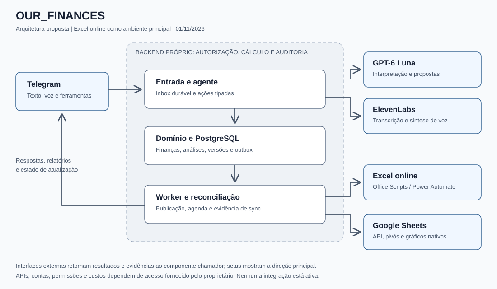
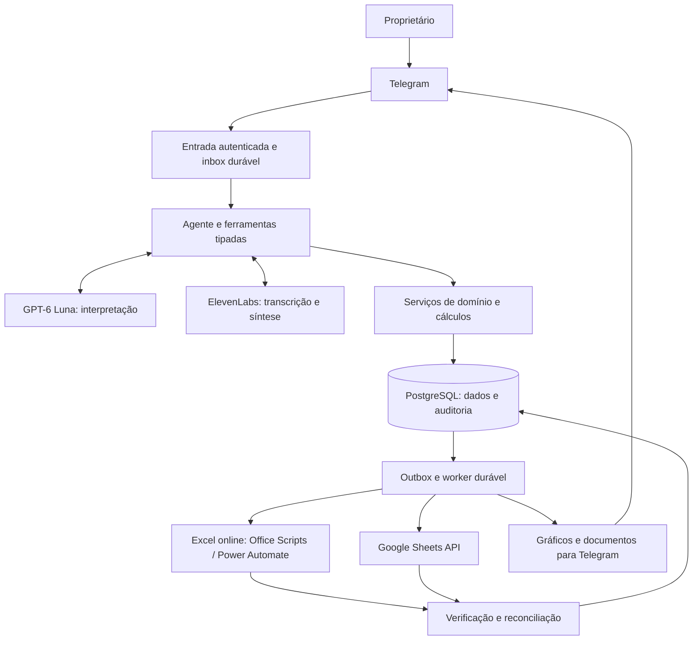

# Arquitetura do OUR_FINANCES

Atualizado em 02/11/2026. Arquitetura alvo com núcleo local implementado; sincronização e objetos nativos online continuam pendentes. Evidências e execução em [docs/validacao.md](docs/validacao.md), [docs/operacao.md](docs/operacao.md) e [docs/retomada.md](docs/retomada.md).

## 1. Escopo e estados das decisões

As marcações distinguem requisitos de escolhas técnicas: `[confirmed]` foi solicitado pelo proprietário; `[recommended]` é uma proposta de implementação; `[open]` depende de acesso, validação ou decisão; `[excluded]` delimita serviços que não serão executados por esta arquitetura.

| Decisão | Estado | Direção | Responsável / prova necessária |
|---|---|---|---|
| Produto próprio e Telegram como interface completa | [confirmed] | Texto, áudio, ferramentas e relatórios no chat. | Proprietário; testes de jornadas. |
| Modelo `gpt-6-luna` | [confirmed] | OpenAI Responses API; sem substituição silenciosa. | Proprietário fornece API; aplicação verifica acesso e capacidades. |
| ElevenLabs no áudio | [confirmed] | Transcrição de entrada e síntese sob demanda. | Proprietário fornece API e escolhe voz. |
| Excel online / Microsoft 365 | [confirmed] | Ambiente principal de planilhas. | Proprietário informa modalidade/licença da conta. |
| Google Sheets, categorias, limites, análise avançada | [confirmed] | Entrega funcional nos dois destinos. | Testes de paridade e aceitação. |
| PostgreSQL como registro financeiro oficial | [recommended] | Planilhas como projeções editáveis por fluxo controlado. | Validar migrações, backup e reconciliação. |
| Office Scripts + Power Automate para Excel | [recommended] | Escrita, criação de objetos e retorno de evidências. | Prova de viabilidade da fase 0. |
| Hospedagem, retenção, orçamento de APIs e metas operacionais | [open] | Escolher antes de operação real. | Proprietário aprova recursos e custos. |
| Movimentar dinheiro e conectar bancos | [excluded] | O sistema organiza registros; não executa pagamentos nem usa Open Finance neste plano. | Nova solicitação se houver ampliação. |

Os requisitos analíticos permanecem no escopo completo. O sequenciamento em fases não autoriza eliminar Excel, Sheets, voz ou controle pelo Telegram.

## 2. Estado atual e referências

O núcleo local inclui banco/migrações, domínio financeiro, processamento durável, Telegram com confirmações, interpretação estruturada, áudio de entrada, análises, cenários, importação protegida e exportações. O desenvolvimento está pausado; hospedagem e conectores Microsoft/Google não foram entregues. Cada instalação usa dados, bot e credenciais próprios.

As três referências contribuem de formas distintas:

- [RafaPassarinho](https://github.com/rafaPassarinho/google-sheets-gemini-automation): captura por voz em português e integração financeira com Sheets. Separar o padrão útil do layout específico da planilha e das dependências adicionais.
- [Template multimodal 10155](https://n8n.io/workflows/10155-multi-modal-expense-tracking-with-telegram-gemini-ai-and-google-sheets/): entrada multimodal convergindo para interpretação estruturada. Reimplementar no backend próprio, usando os provedores escolhidos.
- [OurLifeCosts](https://ourlifecosts.org/en/): categorias, orçamento, relatórios, correção e planilha controlada pelo usuário. Referência de experiência, sem presumir código disponível.

Não copiar prompts, código ou ativos sem verificar licença e atribuição. Dependências e referências mantêm suas próprias condições; veja [THIRD_PARTY_NOTICES.md](THIRD_PARTY_NOTICES.md).

## 3. Arquitetura alvo e limites de confiança





Um monólito modular com dois processos: API/bot e worker. Compartilham código e PostgreSQL. Não introduzir microserviços, Redis, banco vetorial ou uma plataforma de agentes para resolver necessidades ainda não demonstradas.

Limites de confiança:

1. Telegram identifica o remetente, mas conteúdo recebido continua sendo entrada não confiável.
2. OpenAI e ElevenLabs são processadores externos. Enviar apenas os dados necessários à tarefa.
3. Ferramentas não recebem autorização da IA. Autorização vem da sessão e das regras de aplicação.
4. Microsoft e Google recebem projeções financeiras; suas permissões e tokens são independentes.
5. PostgreSQL é a referência para registros aceitos, versões, identidade e trilha de auditoria.

O usuário não precisa abrir um painel administrativo para operar o produto. Autorizações iniciais de contas e consentimentos OAuth podem exigir navegador; operações cotidianas devem existir no Telegram.

## 4. Componentes e responsabilidades

| Componente | Responsabilidade | Não deve fazer |
|---|---|---|
| Adaptador Telegram | Validar origem, usuário/chat, baixar mídia, botões, envio de arquivos e mensagens. | Calcular finanças ou escrever planilha diretamente. |
| Inbox | Persistir evento e chave de idempotência antes de confirmar recebimento. | Confundir recebimento com lançamento concluído. |
| Fronteira IA, `app/ai/llm.py` | Cliente OpenAI, modelo, schemas de ferramentas, extração e interpretação, erros e uso. | Executar SQL, código ou fórmulas produzidos livremente pelo modelo. |
| Adaptador ElevenLabs | STT, TTS, formatos de áudio, duração, falhas e medição de consumo. | Alterar valores financeiros para tornar a fala mais natural. |
| Serviços financeiros | Categorias, orçamento, lançamentos, cartões, metas, autorização e versões. | Depender do layout de células para manter integridade. |
| Motor analítico | Agregações, métricas, cenários e dados para gráficos. | Inventar valores ausentes ou converter moedas sem taxa conhecida. |
| Publicadores de planilhas | Criar/atualizar tabelas, pivôs, gráficos, filtros, validações e fórmulas. | Tomar decisões de categoria ou ocultar falha de sincronização. |
| Worker | Jobs persistentes, agenda, leases, retentativas, relatórios e reconciliação. | Perder jobs quando o processo reinicia. |

## 5. Modelo de dados e organização da vida

Todas as entidades pertencem a um `workspace_id`, mesmo com um único proprietário. Isso permite distinguir finanças pessoais e um espaço compartilhado sem construir um SaaS. O primeiro usuário é proprietário; convidar outra pessoa exige ação explícita no Telegram e regras de acesso.

| Entidade | Campos e regra principal |
|---|---|
| Workspace / Membership | Nome, moeda-base, fuso, proprietário, papel e Telegram user ID autorizado. Username não é identidade. |
| LifeArea | Área da vida criada pelo usuário: Saúde, Casa, Educação, Trabalho, Família, Lazer. Nomes são exemplos, não enum fixo. |
| Category | UUID, nome, tipo receita/despesa, pai opcional, área, aliases e ativo. Impedir ciclos e pais incompatíveis. |
| Tag / Project | Marcadores e projetos/objetivos para análises transversais sem duplicar movimentações. |
| Account | Caixa, conta bancária, cartão/passivo, saldo inicial e data, moeda. Não implica conexão bancária. |
| Transaction | UUID, tipo, descrição, moeda, datas, status, conta, contraparte de transferência, origem e revisão. Classificações fixo/variável e essencial/discricionário são configuráveis, com herança da categoria e override auditado. |
| Allocation | Partes da movimentação por categoria/área/projeto. A soma em centavos deve igualar o valor total. |
| Installment / Recurrence | Parcela, vencimento, total, referência de compra; recorrência e ocorrência única por período. |
| Budget | Escopo, valor, janela, regime, vigência, alertas, eventual transferência de saldo e revisão. |
| Goal | Valor-alvo, prazo, saldo reservado e contribuições vinculadas. Reservar não cria receita ou despesa fictícia. |
| ReportDefinition | Dimensões, métricas, filtros, gráfico, destino, nome e revisão da análise salva. |
| Scenario | Premissas e resultados separados dos fatos financeiros. |
| InboundEvent / PendingAction | Evento original, ação proposta, hash, validade, dono e estado da conversa. |
| AuditEvent | Autor, ação, objeto, antes/depois mínimo, horário, motivo e correlation ID. |
| OutboxJob / Publication | Destino, revisão, tentativas, lease, status, IDs de objetos externos e evidência da publicação. |
| ImportBatch / ImportRow | Origem, hash, linha externa, versão-base, prévia, erros e confirmação. |

Categorias podem ser criadas, renomeadas, reparentadas, arquivadas e mescladas pelo Telegram. Excluir categoria com histórico vira arquivamento ou exige migração confirmada. Renomear preserva UUID. Reclassificar histórico requer prévia com período e quantidade de registros.

Áreas e categorias têm histórico de mudanças. Relatórios podem usar classificação atual ou classificação da época, explicitando a escolha. O padrão proposto é classificação atual para exploração e snapshots para fechamentos já publicados.

Limites podem ser semanais, mensais, anuais ou de período definido; por área, categoria/subcategoria, projeto ou responsável. Pais incluem os descendentes uma única vez. Tags servem para filtragem, mas total geral sempre deduplica allocations. Sobreposição de limites é permitida e explicada; não somar seus tetos como se fossem um orçamento consolidado único.

`null` significa sem limite; zero significa limite de zero. Alertas de 80% e 100% são sugestões configuráveis. Estourar limite informa o usuário e não impede registrar um fato ocorrido.

## 6. Regras financeiras determinísticas

1. Valores de lançamentos são inteiros na unidade mínima da moeda original: centavos para BRL. A precisão monetária vem da moeda, não de um fator 100 universal. Taxas e juros usam Decimal. Contravalor na moeda-base só existe com taxa, data, origem e arredondamento explícitos; sem isso, manter o valor original separado. Nenhum total financeiro depende de float binário ou da resposta da IA.
2. Despesas e receitas têm magnitude positiva e tipo explícito. Estorno/reembolso referencia o lançamento original e reduz a despesa correspondente; não é receita de trabalho.
3. Transferência gera pernas vinculadas e balanceadas. Não aumenta receita nem despesa consolidada. Taxa bancária é despesa separada.
4. Compra no cartão é despesa/compromisso; pagamento da fatura transfere saldo para quitar passivo. Nunca contar os dois como consumo.
5. Compra parcelada distingue valor total, reconhecimento de consumo e vencimentos. Regime de orçamento por caixa ou competência deve estar definido e visível. Visões não são somadas entre si.
6. Parcelas e divisões distribuem resíduos de centavos por regra estável; sua soma é exatamente igual ao original.
7. Datas guardam instante UTC de recebimento e datas locais de ocorrência, competência e liquidação. `America/Sao_Paulo` é a proposta inicial; usuário pode alterar o fuso.
8. Agregações usam intervalo local fechado no início e aberto no fim. Meses incompletos são sinalizados em comparações.
9. Moeda inicial proposta: BRL. Estrutura guarda moeda; total entre moedas diferentes exige taxa e data aprovadas. Na ausência disso, apresentar separado.
10. Saldo disponível vem de saldos iniciais e movimentos conciliados. Patrimônio depende de ativos/passivos informados; dados faltantes geram indicador de cobertura, não saldo inventado.
11. Percentual com denominador zero retorna sem base comparável. Receita líquida, poupança, comprometimento e projeção usam definições versionadas no catálogo de métricas.
12. Correções incrementam revisão e registram auditoria; desfazer cria compensação ou restaura versão de forma rastreável. Não apagar evidência para fazer os números baterem.

## 7. Fluxo do agente no Telegram

```mermaid
sequenceDiagram
    participant U as Usuário autorizado
    participant B as Bot / Inbox
    participant E as ElevenLabs
    participant L as GPT-6 Luna
    participant D as Domínio / PostgreSQL
    participant W as Worker
    U->>B: Texto, áudio ou comprovante
    B->>D: Persistir evento único
    opt Entrada em áudio
        B->>E: Transcrever mídia autorizada
        E-->>B: Texto e metadados
    end
    B->>L: Texto + contexto mínimo + ferramentas permitidas
    L-->>B: Proposta estruturada
    B->>D: Autorizar e validar regras
    alt Ambiguidade ou ação de alto impacto
        B-->>U: Prévia vinculada a ação e versão
        U->>B: Confirmar / corrigir / cancelar
    end
    B->>D: Commit do fato + auditoria + outbox
    B-->>U: Registrado; sincronização em andamento
    W->>D: Obter job com lease
    W->>W: Publicar e verificar cada destino
    W->>D: Registrar revisão e evidência externa
    W-->>U: Atualizado ou pendência específica
```

Estados persistidos: recebido, normalizando, interpretando, aguardando esclarecimento, aguardando confirmação, registrado, publicando, sincronizado, falha recuperável e cancelado. Cada destino tem estado próprio.

Lançamento simples, completo e autorizado pode ser registrado direto com opção Desfazer. No piloto, começar com confirmação explícita; habilitar registro direto após avaliação e escolha do proprietário. Categorias semelhantes, conta não identificada, valor duvidoso e moeda ausente exigem esclarecimento.

Criar/alterar orçamento, reclassificar lote, mesclar categoria, importar histórico e excluir dados mostram prévia. A confirmação fica vinculada a usuário, chat, workspace, payload, revisão-base e validade. Botão antigo ou de outro usuário não autoriza ação. Uma frase que contém várias despesas mantém índice de item no evento; uma resposta ao item 2 não altera o item 1.

A confiança declarada pelo modelo é apenas um sinal, nunca uma probabilidade calibrada. A gravação automática exige schema válido, campos completos, correspondência de identidade e política aprovada. Um limite numérico de confiança, se usado, será calibrado com exemplos do produto.

## 8. Ferramentas e cobertura pelo Telegram

| Grupo de ferramentas | Ações oferecidas |
|---|---|
| Organização | Criar/listar/alterar/arquivar áreas, categorias, aliases, projetos, tags e metas. |
| Orçamento | Definir/consultar/alterar limites, periodicidade, regime, alertas e saldo transportável. |
| Financeiro | Registrar receitas/despesas/transferências, dividir gastos, corrigir, estornar, parcelar, criar recorrências e marcar liquidação. |
| Consulta | Buscar lançamentos, abrir detalhes e conferir total de um período com origem rastreável. |
| Análise | Consultar métricas, comparar períodos, criar cenário, criar/editar tabela dinâmica e gráfico, salvar análise e configurar filtros. |
| Planilhas | Criar pasta de trabalho autorizada, sincronizar, reconstruir áreas geradas, exportar XLSX/CSV e importar alterações pela aba de entrada. |
| Rotinas | Agendar resumo/alerta, consultar agenda, pausar e cancelar rotina. Não enviar a destinatários não autorizados. |
| Operação | Consultar saúde, pendências, consumo de API e revisão publicada; reprocessar job com autorização. |
| Áudio | Transcrever entrada e narrar resumo já validado; preferências texto/voz por conversa. |

O GPT propõe chamadas com schemas fechados. O servidor injeta identidade e workspace; argumentos do modelo não podem trocar o escopo. Consultas analíticas compilam dimensões e métricas permitidas para SQL parametrizado. Não permitir SQL, Python, JavaScript ou fórmulas arbitrárias fornecidos pela IA. Pedidos de nova análise produzem uma ReportDefinition validada.

Novas métricas com semântica desconhecida exigem esclarecer sua definição. Não inventar uma fórmula só porque o pedido contém a expressão "análise sofisticada".

## 9. Planilhas: organização, visões e paridade

Pasta de trabalho por workspace. Uma tabela transacional contínua evita duplicar lógica em uma aba por mês. Abas analíticas filtram períodos. Separar abas geradas das áreas de entrada e de análises manuais.

| Aba | Conteúdo e interação |
|---|---|
| Inicio | Links, último sync, período, filtros, indicadores, cobertura e instruções curtas. |
| Lancamentos | Tabela estruturada com UUID, revisão, valores, datas, dimensões e origem. Área gerada/protegida. |
| Rateios | Uma linha por allocation, com UUID próprio e UUID da movimentação; fonte de composição e orçamento por categoria. |
| Categorias | Árvore, áreas, aliases e estado; valores oficiais publicados. |
| Orcamentos | Vigência, limites, realizado, disponível, percentual e alertas. |
| Contas_Cartoes | Saldos, faturas, compromissos, vencimentos e cobertura dos dados. |
| Metas_Projetos | Reservas, contribuições, evolução e orçamento por projeto. |
| Fluxo_Caixa | Histórico, compromissos futuros, projeções e cenário selecionado. |
| Painel_Mensal | Indicadores, comparações, gráficos, filtros e alertas. |
| Painel_Anual | Evolução, acumulados, sazonalidade e comparação entre anos. |
| Tabelas_Dinamicas | Pivôs nativos criados/alterados pelo agente. |
| Analises_Salvas | Catálogo das definições e links para objetos publicados. |
| Cenarios | Premissas editáveis e resultados separados do realizado. |
| Entrada_Alteracoes | Formulário tabular para inclusão/ajuste, UUID, revisão-base, status e erros. |
| Conferencias | Contagens, total por moeda/tipo, somas, revisão, hash e divergências. |
| Configuracao | Parâmetros visíveis do relatório; sem segredos ou tokens. |

Excel e Sheets possuem os mesmos fatos, métricas e filtros semânticos. Fórmulas e objetos nativos são gerados por adaptadores próprios; não presumir que converter XLSX preserva segmentações e pivôs nos dois sentidos.

Requisitos de apresentação: moeda e datas legíveis, linhas congeladas, tabelas expansíveis, listas validadas, nomes estáveis, formatação condicional e fórmulas protegidas. Inputs manuais em azul; fórmulas em preto; referências entre abas em verde, com legenda. Acessibilidade não pode depender apenas de cor.

Fórmulas derivadas precisam permanecer auditáveis na planilha quando o mecanismo oferecer equivalência. Resultados do motor analítico materializados como dados devem identificar métrica, período, versão e origem; não apresentá-los como fórmulas recalculáveis. Dataframes são auxiliares, não autoridade monetária.

### 9.1 Granularidade e população das métricas

- `Lancamentos` tem uma linha por Transaction; `Rateios` tem uma linha por Allocation. Não juntar e repetir o valor integral do lançamento em cada rateio.
- Gasto por categoria soma valores alocados. Frequência financeira conta UUIDs distintos de movimentações na população filtrada; quantidade de rateios é outra métrica, com outro nome.
- Ticket global é valor das movimentações filtradas dividido por sua contagem distinta. Ticket alocado por categoria é valor atribuído à categoria dividido pelas movimentações distintas daquela categoria. Medianas seguem a mesma população declarada.
- Ao cruzar categorias, um lançamento pode aparecer em mais de um grupo. Frequências de grupos não são somáveis para obter frequência global; médias e medianas de grupos também não formam o total.
- Fontes e métricas de cada ReportDefinition declaram seu grão. Quando o pivô nativo não suporta contagem distinta ou a medida não aditiva, mostrar a medida calculada pelo motor em uma área auxiliar identificada; não usar COUNT de rateios ou SUM de médias como substituto. Pivôs de soma financeira continuam sendo objetos nativos. Contagem nativa de linhas deve ter rótulo correspondente ao grão utilizado.
- Teste obrigatório: compra de R$ 600,00 dividida em dois rateios de R$ 300,00. Total global R$ 600,00, uma movimentação, dois rateios e ticket global R$ 600,00. Cada categoria recebe R$ 300,00; o total de transações não pode virar dois.

## 10. Catálogo de análises financeiras e organizacionais

As análises padrão devem existir desde o primeiro workbook, sem pedido ao agente para criá-las. O lançamento confirmado aciona a publicação e atualiza os painéis instalados; relatórios novos pelo chat são personalização adicional. Base contínua, seleção de mês/ano e rotina de virada sem lançamentos preservam o histórico. Requisitos e alternativas para a conta Microsoft 365 Personal estão em [docs/excel-pessoal.md](docs/excel-pessoal.md); a publicação do XLSX completo pelo OneDrive é uma rota proposta para prova, ainda não implementada nem equivalente à API de workbook.

| Família | Análises obrigatórias | Controles |
|---|---|---|
| Orçamento | Planejado x realizado, desvio em R$ e %, disponível, consumo diário e projeção de estouro. | Regime e janela visíveis; sem teto vira sem limite. |
| Evolução | Dia/semana/mês/ano, acumulado anual, comparação mensal/anual e médias móveis. | Sinalizar períodos incompletos e insuficiência de histórico. |
| Composição | Participação por área/categoria, Pareto, ranking, fixo x variável e essencial x discricionário. | Classificações configuradas pelo usuário, não juízo moral da IA. |
| Distribuição | Ticket médio/mediano, dispersão, frequência, calendário de gastos e identificação de valores fora do padrão. | Outlier é sinal explicável, não fraude ou erro presumido. |
| Caixa e crédito | Saldos, recebíveis, pagamentos previstos, calendário de faturas, parcelas e comprometimento futuro. | Compra e pagamento de cartão não duplicam consumo. |
| Metas | Poupança líquida, taxa de poupança, progresso de reserva, prazo e contribuições por projeto. | Transferências e reembolsos tratados corretamente. |
| Organização | Agenda de obrigações, assinaturas/recorrências, despesas por projeto, revisões periódicas e lembretes. | Rotinas configuráveis e auditadas; sem criar um gestor genérico de tarefas. |
| Cenários | Redução de categoria, alteração de renda, despesa extraordinária, projeção base/otimista/conservadora. | Premissas explícitas; não alterar fatos nem prometer previsão. |
| Patrimônio e dívidas | Ativos/passivos informados, patrimônio líquido e cronograma de dívida com taxas fornecidas. | Exibir cobertura; não buscar cotações ou taxas sem integração autorizada. |
| Exploração | Pivôs com múltiplas dimensões, drill-down, filtros, análises salvas e gráficos personalizados. | Mesma especificação semântica nos dois destinos. |

Tipos de gráfico: barras, colunas, linhas, combinação, dispersão, cascata e mapa de calor; rosca para composição limitada. Pareto combina ranking e acumulado. Quando um tipo não existir nativamente no destino, entregar série/fórmula equivalente e imagem no Telegram, mantendo uma visualização editável adequada na planilha. Essa diferença deve estar visível no catálogo, sem chamar imagem de gráfico nativo.

Pivô verdadeiro permite alterar linhas, colunas, métricas, filtros e período. Métricas padrão: soma, contagem, média, mínimo e máximo. Mediana, taxa de poupança e outros cálculos fora da capacidade do pivô usam medidas derivadas explícitas, calculadas com a população correta. Média e percentuais não são somados por categoria para formar o total.

Segmentações de período, área, categoria, projeto, responsável, conta, tipo e status. Excel: segmentações suportadas por Office Scripts; Sheets: slicers e filter views via API. O teste de paridade verifica o resultado filtrado, não apenas a presença visual do controle.

## 11. Integração e sincronização confiável

| Ligação | Interface / autenticação | Direção e autoridade | Repetição e prova |
|---|---|---|---|
| Telegram | Bot API; token próprio; webhook secret e allowlist. | Entrada e resposta; evento é evidência, não autoridade financeira. | Chave bot/update; autorizar também callbacks. |
| OpenAI | Responses API; chave própria. | Contexto mínimo entra; proposta estruturada sai. | Uso/request ID; recusa/timeout não gera gravação. |
| ElevenLabs | APIs STT/TTS; chave própria. | Mídia autorizada entra; transcrição/áudio sai. | Hash e estado de tarefa; sem repetir gasto financeiro ao repetir STT. |
| Excel online | Power Automate autenticado + Office Scripts. | Projeção sai; alterações entram pela área de entrada. | Job e revisão no workbook; ler UUIDs/totais/resultado após escrita. |
| Sheets | Sheets API e OAuth/conta de serviço aprovada. | Mesmo contrato semântico de projeção e entrada. | UUID/revisão, batchUpdate, backoff e reconciliação. |

Commit financeiro e criação da outbox acontecem na mesma transação PostgreSQL. O worker usa lease durável e execução serial por workbook. Retentativas têm backoff, limite e estado de revisão manual; falhas não desaparecem.

Cada evento tem unicidade `(bot_id, update_id)`. Itens financeiros usam `(event_id, item_index, action_type)`. Mensagem editada vira proposta de revisão. Dois gastos legítimos de mesmo valor/data/descrição não podem ser eliminados apenas por hash de conteúdo.

Cada mudança que afeta dados, esquema ou definição analítica incrementa uma `projection_revision` monotônica do workspace. O destino mantém `last_verified_revision` e `target_revision`. Job de revisão inferior à já publicada é obsoleto e não pode escrever; coalescer jobs somente em um snapshot mais recente que inclua todas as mudanças pendentes. Avisar que um pedido foi incorporado à publicação mais nova, sem repetir sua ação financeira.

Antes da escrita, o publicador revalida revisão e exclusividade por workbook. A lease possui token de fencing e a execução Microsoft é serial no fluxo. Lease expirada não autoriza dois escritores: job com escrita externa incerta bloqueia novas escritas nesse workbook até confirmar término ou reconciliar. Um worker antigo não pode finalizar estado com token vencido. Google exige a mesma exclusividade no publicador; não presumir compare-and-swap nativo de células. Testar publicação 11 seguida de job 10, revisão de relatório sem mudança financeira e retomada de lease expirada.

Publicação é pelo menos uma vez, com efeitos idempotentes: localizar UUID/objeto existente antes de inserir, revisar estado externo após timeout e reprocessar sem append cego. Um destino atrasado não provoca rollback do fato financeiro já confirmado. Exibir "registrado; Excel pendente" quando necessário.

Versões de dados, esquema e relatório são registradas separadamente. Publicação usa snapshot consistente. Ao final, comparar contagem e totais por moeda/tipo com o snapshot; recuperar divergências e só então avançar watermark. Não existe transação atômica entre PostgreSQL, Excel e Sheets.

### 11.1 Excel online: prova obrigatória antes de prometer refresh

Office Scripts oferece criação de [tabelas dinâmicas](https://learn.microsoft.com/en-us/office/dev/scripts/develop/pivottables). A automação via Power Automate requer [licença Microsoft 365 empresarial elegível](https://learn.microsoft.com/en-us/office/dev/scripts/develop/power-automate-integration), ainda não confirmada.

A documentação também alerta que métodos de refresh de pivôs podem retornar sucesso sem atualizar quando executados em um fluxo. Portanto `refreshAllPivotTables()` não será critério de sucesso. Ver [limitações documentadas de refresh](https://learn.microsoft.com/pt-br/office/dev/scripts/testing/power-automate-troubleshooting).

Estratégia proposta: atualizar tabela-base e fórmulas; criar/recriar os pivôs gerados a partir de ReportDefinition sobre a revisão atual, preservando a especificação e filtros selecionados. Isso exige uma prova real de criação, dados atuais, segmentações e repetição. Não executar reconstrução de objetos manuais do usuário. Se o caminho não funcionar no tenant, comunicar a limitação e decidir um mecanismo compatível com o proprietário antes de continuar essa integração. Nenhum requisito de pivô será silenciosamente trocado por uma tabela estática.

Power Query, Power Pivot e autoria DAX têm diferenças entre desktop e web. O núcleo não depende de Power Query refresh remoto nem promete DAX editável no navegador. O modelo dimensional e as métricas serão entregues pela camada analítica e objetos suportados no Excel online. Recursos adicionais específicos de Power Query/Data Model exigem validação própria de conta e suporte.

### 11.2 Edição diretamente nas planilhas

`Lancamentos` é uma projeção gerada; `Entrada_Alteracoes` é a entrada editável. O usuário pode preparar inclusões, categorias, limites ou ajustes nessa aba e mandar "importa minhas alterações" no Telegram. Um poll autenticado pode detectar candidatos e avisar, mas não se presume webhook de edição de célula.

O importador lê UUID, revisão-base e campos permitidos, produz prévia, valida e confirma pelo Telegram. Havendo conflito com edição no chat, não vence automaticamente o último gravador: mostrar diferenças e pedir resolução. Proteger fórmulas é ajuda de uso; autorização real fica no backend.

Áreas e abas manuais são preservadas. Alteração inesperada em área gerada vira divergência e é apresentada antes de reconstrução destrutiva. Não sobrescrever trabalho manual silenciosamente.

## 12. IA, áudio e avaliações

`gpt-6-luna` é o modelo obrigatório. Suporta texto/imagem, ferramentas e saída estruturada; áudio não é modalidade direta nesse modelo. Usar ElevenLabs para STT e TTS. Capacidades verificadas na [página oficial](https://developers.openai.com/api/docs/models/gpt-6-luna), sem presumir habilitação da futura chave.

Antes da implementação real: pedir chave OpenAI, validar catálogo/acesso e executar chamada mínima; depois pedir chave ElevenLabs, confirmar endpoints/modelos de áudio disponíveis e uma voz PT-BR. Não usar credenciais antigas nem trocar provedores por conveniência.

Resumos usam dados calculados e referências de período/métrica. Entradas de planilhas, comprovantes e transcrições são dados não confiáveis; não podem redefinir ferramentas ou instruções. O agente não tem shell, navegação livre, acesso irrestrito ao Drive nem capacidade de instalar fórmulas executáveis.

Uma única fronteira `app/ai/llm.py` contém chamadas OpenAI e schemas de ferramentas. Um adaptador separado `app/audio/elevenlabs.py` contém somente processamento de áudio. Salvar versões de interpretação, esquema, regras, modelo e relatório. Não enviar segredos ou histórico financeiro completo quando agregados bastarem.

Áudios de entrada têm limites de tamanho/duração configurados e expostos no chat. O formato de saída deve ser compatível com envio de voz no Telegram; converter com FFmpeg quando necessário. Texto permanece como registro dos valores. Falha de TTS não reverte lançamento nem oculta resposta textual.

A avaliação começa com exemplos fictícios rotulados como tal, pois ainda não existem traces deste produto. Incluir no mínimo 20 casos de interpretação, jornadas com múltiplas interações, ações proibidas e falhas de provedor. Separar regressão de casos difíceis. Acrescentar casos reais somente com consentimento e anonimização. Comparações pequenas são exploratórias, sem prometer taxa geral de acerto.

Verificar estado final no banco e planilhas, não apenas a fala do agente. Testes monetários são determinísticos; revisão semântica é humana no início. Um juiz por IA separado exigiria escolha e acesso adicionais do proprietário; não acrescentar outro modelo por padrão nem declarar juiz calibrado sem evidência.

## 13. Segurança, privacidade e autorização

- Identidade por Telegram user ID e membership; grupos só após vinculação explícita. Informação privada não é enviada a grupo por inferência da IA.
- Secret de webhook, HTTPS em produção, autenticação dos fluxos Microsoft e callbacks protegidos. Não usar URL pública anônima como único controle de escrita.
- Pedir todas as APIs, contas, permissões e acessos ao proprietário no momento necessário. Não procurar chaves em outros projetos, perfis, históricos ou cofres sem solicitação.
- Segredos fora de Markdown e Git; credenciais em ambiente/cofre; refresh tokens cifrados e chave de cifra separada do banco.
- OAuth com menor escopo possível e restrição interna por workbook/spreadsheet IDs. Se a plataforma exigir escopo mais amplo, explicar antes do consentimento.
- Logs estruturados com IDs e estados; mensagens, áudio, tokens e dados financeiros sensíveis ficam redigidos por padrão.
- Tratar conteúdo começando por caracteres de fórmula como texto em importações/exportações. Só templates de fórmula confiáveis são executáveis.
- Sem pagamentos, clonagem de voz ou conexão bancária implícitos. Não enviar avisos para terceiros sem destinatário autorizado.
- Retenção proposta: mídia transitória apagada após processamento, ressalvadas pendências autorizadas; períodos de auditoria, backup e anexos devem ser escolhidos antes de produção.
- Exportar/excluir dados mediante solicitação confirmada; explicitar tratamento de backups e retenção dos fornecedores. Não prometer apagar cópias externas sem mecanismo correspondente.

## 14. Confiabilidade, operação e recuperação

Outbox e agenda vivem no PostgreSQL. Reiniciar aplicação não perde esclarecimentos pendentes, horários, jobs ou confirmações. Cada execução tem correlation ID, número de tentativas e último erro seguro. Endpoints de health não expõem dados pessoais.

| Falha | Comportamento | Recuperação |
|---|---|---|
| OpenAI indisponível | Persistir entrada; avisar que a interpretação está pendente. | Retentar com o mesmo modelo; não trocar silenciosamente. |
| ElevenLabs indisponível | Texto continua funcionando; áudio fica pendente ou usuário reenvia em texto. | Retomar áudio sem duplicar o evento financeiro. |
| Microsoft/Google indisponível | Registro oficial permanece; destino mostra atraso. | Outbox, reconciliação e republicação da revisão correta. |
| Processo cai após gravar externamente | Estado do job pode estar incerto. | Consultar UUID/revisão no destino antes de repetir. |
| Token expirado/revogado | Pausar somente o destino e explicar qual consentimento é necessário. | Pedir reconexão ao proprietário. |
| Fórmula/pivô divergente | Não marcar publicação como verificada. | Conferir snapshot e reconstruir somente objetos gerados autorizados. |
| Exclusão/alteração indevida | Bloquear ação ou publicar aviso de conflito. | Auditoria, reversão, backup e revisão pelo proprietário. |

Backup inclui banco, definições analíticas, parâmetros e referências de publicação; segredos são recuperados por processo separado. Testar restauração em ambiente isolado antes do piloto.

RPO e RTO permanecem `[open]`: o proprietário escolherá quanto histórico pode perder e quanto tempo pode ficar sem serviço. Propostas de latência e cadência de sync serão medidas no piloto, não apresentadas como SLA contratado. Telegram mantém updates pendentes por tempo limitado; serviço offline não é uma fila infinita.

Chaves de bloqueio (kill switch): pausar novas mutações, pausar um destino, pausar consumo de IA e pausar áudios. Consulta e exportação local devem continuar quando possível. O comando administrativo não pode ser acionado por usuário não autorizado.

## 15. Decisões pendentes e riscos de implantação

| Risco / ponto em aberto | Efeito | Controle / próximo passo | Responsável |
|---|---|---|---|
| Modalidade Microsoft 365 incompatível com automação | Impede integração online prevista. | Pedir modalidade de conta e provar Office Scripts/Power Automate antes do conector completo. | Proprietário + implementação. |
| Refresh de pivô sem efeito | Planilha aparenta sucesso com dado antigo. | Criação/reconstrução validada e leitura dos números, sem confiar só em HTTP 200. | Implementação. |
| Custos de API/conectores | Despesa recorrente não prevista. | Pedir orçamento e aprovação antes de contratar; medir uso. | Proprietário. |
| Duas planilhas e chat alterando o mesmo dado | Conflitos e perda de edição. | UUID, revisão-base, staging e confirmação. | Implementação + proprietário. |
| Identidade compartilhada no Telegram | Exposição ou ação indevida. | Workspace explícito, memberships e confirmação vinculada. | Implementação. |
| Dados insuficientes para análise | Conclusões enganosas. | Cobertura, premissas e histórico mínimo visíveis. | Motor analítico. |
| Mecanismo Excel ainda não provado | Planejamento tratado como garantia de plataforma. | Fase 0 com evidência e decisão antes de integração real. | Implementação. |

## 16. Aceitação técnica

Cada requisito tem uma fase e prova em [PLANO.md](PLANO.md). A entrega exige registros sem duplicidade, correções reversíveis, valores reconciliados, categorias dinâmicas, orçamento hierárquico, análises salvas e objetos nativos nas duas plataformas. O agente deve criar, alterar e consultar essas estruturas sem edição manual de código.

Antes do uso real: testes de autorização e falhas, validação de planilhas no Excel online e Sheets, prova de restauração, revisão dos custos e aceite dos acessos pelo proprietário. Este documento não autoriza criar contas, contratar serviços ou executar deploy. O proprietário confirmou Microsoft 365 Personal em 02/11/2026; a rota de automação empresarial permanece pendente de decisão, conforme [estado dos acessos](docs/acessos.md).
