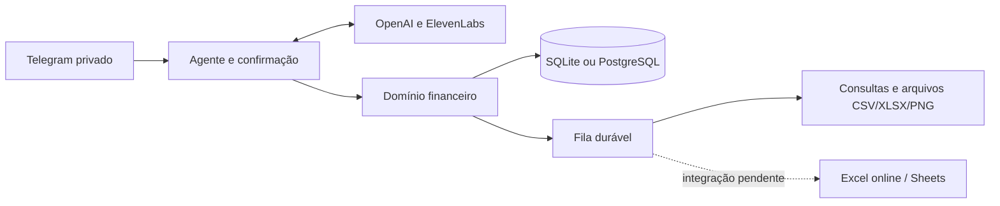

# Our Finances

Registre despesas pelo Telegram e consulte categorias, limites, metas, gráficos e planilhas XLSX.

[](https://github.com/gabriel-menezes-morais/our-finances/actions/workflows/ci.yml)
[](LICENSE)

**Desenvolvimento ativo pausado.** Este repositório publica uma base experimental para estudo, uso próprio e continuação por quem quiser contribuir. Cada instalação precisa de seu próprio bot e credenciais. Não há serviço público hospedado.

## O que funciona

| Recurso | Estado |
|---|---|
| Categorias, áreas da vida, projetos, tags e contas | Implementado |
| Receitas, despesas, rateios, transferências, reembolsos, cartões e parcelas | Implementado |
| Limites, metas, contribuições, recorrências e agenda | Implementado |
| Prévia, confirmação, correção, desfazer e auditoria | Implementado |
| Telegram privado, propostas estruturadas com GPT-6 Luna e transcrição ElevenLabs | Implementado; exige configuração própria |
| Consultas, cenários, gráficos PNG e exportações CSV/XLSX | Implementado localmente |
| Importação de alterações CSV/XLSX com prévia e controle de revisão | Implementado |
| SQLite, PostgreSQL, migrações, filas duráveis e backup cifrado | Implementado |
| Resposta falada ElevenLabs | Código preparado; exige escolha de voz/modelo e teste real |
| Sincronização Excel online e Google Sheets | Pendente |
| Pivôs e segmentações nativos online, painel completo e virada automática no workbook | Pendente |
| Compartilhamento por convite e exclusão definitiva pelo agente | Pendente |

A exportação XLSX contém tabelas, fórmulas e gráficos, mas não substitui a integração online nem comprova atualização de tabelas dinâmicas. As limitações da conta Microsoft 365 Personal estão em [Excel pessoal](docs/excel-pessoal.md).

## Testar sem contas nem chaves

Requisitos: Git, [uv](https://docs.astral.sh/uv/getting-started/installation/) e Python 3.12. O uv pode instalar a versão Python necessária.

```sh
git clone https://github.com/gabriel-menezes-morais/our-finances.git
cd our-finances
uv sync --locked
uv run --locked python -m scripts.smoke_local
```

A demonstração cria uma jornada fictícia com banco SQLite separado, confirmações, relatórios CSV/XLSX/PNG e backup/restauração. Os caminhos dos arquivos ficam em `data/sandbox/local-validation.json`. Nenhuma chamada de rede ou de API é feita nessa jornada. Ela não inicia o bot.

Para executar lint, análise de tipos e testes:

```sh
uv run --locked python -m scripts.check_all --coverage
```

Os testes de PostgreSQL são opcionais e ficam pulados sem uma URL de sandbox explícita. Veja [validação](docs/validacao.md) e [operação](docs/operacao.md).

## Usar com seu Telegram

1. Crie seu próprio bot em [@BotFather](https://t.me/BotFather), com `/newbot`.
2. Copie `.env.example` para `.env`. No PowerShell: `Copy-Item .env.example .env`; em Linux/macOS: `cp .env.example .env`. Faça isso apenas na instalação inicial, sem sobrescrever uma configuração existente.
3. Preencha no editor local `TELEGRAM_BOT_TOKEN` e `OPENAI_API_KEY`. Para receber áudio, preencha também `ELEVENLABS_API_KEY`. Mantenha `APP_MODE=offline` durante o cadastro.
4. Vincule sua conta ao bot pelo link de uso único exibido pelo comando:

```sh
uv run --locked python -m app.telegram.setup
```

O pareamento grava `TELEGRAM_OWNER_USER_ID` localmente. Depois, inicie:

```sh
uv run --locked python -m app.main --connected
```

O bot responde somente ao proprietário pareado em conversa privada. Uma alteração financeira gera prévia e exige confirmação. Encerre com Ctrl+C. O processo depende do computador ligado enquanto a execução for local; este repositório não instala um serviço permanente.

O modelo configurado é `gpt-6-luna`, sem troca automática por outro. A conta OpenAI precisa ter acesso ao identificador configurado. Texto e imagens são processados pela OpenAI; áudio de entrada passa pela ElevenLabs. Síntese exige `ELEVENLABS_VOICE_ID` e `ELEVENLABS_TTS_MODEL` escolhidos por quem instala.

## Exemplos

```text
Crie a categoria Alimentação.
Crie uma conta chamada Conta principal, em reais.
Defina um limite mensal de 900 reais para Alimentação.
Gastei 38,50 no almoço hoje, na categoria Alimentação, pela Conta principal.
Corrija o último lançamento para 28,50.
Mostre meus gastos por categoria e mês.
```

Comandos: `/ajuda`, `/status`, `/resumo`, `/lancamentos`, `/categorias`, `/contas`, `/limites`, `/metas`, `/agenda`, `/grafico`, `/exportar xlsx`, `/exportar csv` e `/desfazer`.

`/pausar` e `/retomar` aceitam `ia`, `audio`, `registros`, `excel`, `sheets`, `rotinas` ou `tudo`, com confirmação. Esses comandos controlam funções do aplicativo; encerrar o processo é o que libera a memória do computador.

## Arquitetura e execução



Python 3.12, aiogram, FastAPI, Pydantic, SQLAlchemy/Alembic, openpyxl e Matplotlib. Valores financeiros usam unidades mínimas da moeda; taxas usam Decimal. A IA propõe ações; autorização, cálculos e gravação pertencem ao domínio.

SQLite é suficiente para testar localmente. Para PostgreSQL e Docker, consulte [operação](docs/operacao.md). O `render.yaml` é um template opcional de infraestrutura paga, sem credenciais. Não há provedor contratado ou dependência obrigatória de Render.

## Documentação

| Documento | Conteúdo |
|---|---|
| [ARQUITETURA.md](ARQUITETURA.md) | Componentes, dados e invariantes |
| [STACK.md](STACK.md) | Tecnologias e limites dos provedores |
| [PLANO.md](PLANO.md) | Roadmap e tarefas pendentes |
| [docs/operacao.md](docs/operacao.md) | Banco, execução, filas, backup e restauração |
| [docs/telegram.md](docs/telegram.md) | Bot próprio, pareamento e comandos |
| [docs/acessos.md](docs/acessos.md) | Credenciais necessárias por integração |
| [docs/metricas.md](docs/metricas.md) | Definições e regras das análises |
| [docs/excel-pessoal.md](docs/excel-pessoal.md) | Viabilidade Personal, painéis prontos e meses |
| [docs/validacao.md](docs/validacao.md) | Testes, evidências e limites |
| [docs/retomada.md](docs/retomada.md) | Como continuar o desenvolvimento |

## Segurança e contribuição

`.env`, credenciais, bancos, backups, mídia, logs e exportações ficam fora do Git. Não envie valores de chaves em issues ou pull requests. Use dados fictícios ao relatar um problema. Mais detalhes em [SECURITY.md](SECURITY.md) e [CONTRIBUTING.md](CONTRIBUTING.md).

O projeto não movimenta dinheiro, conecta bancos nem executa pagamentos. Antes de usar dados reais, revise permissões, retenção, custos das APIs e recuperação de backups.

## Licença e referências

[MIT](LICENSE), copyright Gabriel Menezes Morais. Dependências e serviços externos têm licenças e termos próprios.

Referências de experiência: [RafaPassarinho](https://github.com/rafaPassarinho/google-sheets-gemini-automation), [template multimodal 10155](https://n8n.io/workflows/10155-multi-modal-expense-tracking-with-telegram-gemini-ai-and-google-sheets/) e [OurLifeCosts](https://ourlifecosts.org/en/). Veja [THIRD_PARTY_NOTICES.md](THIRD_PARTY_NOTICES.md).
